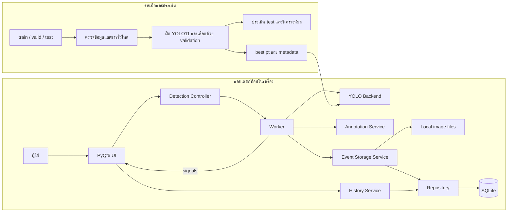
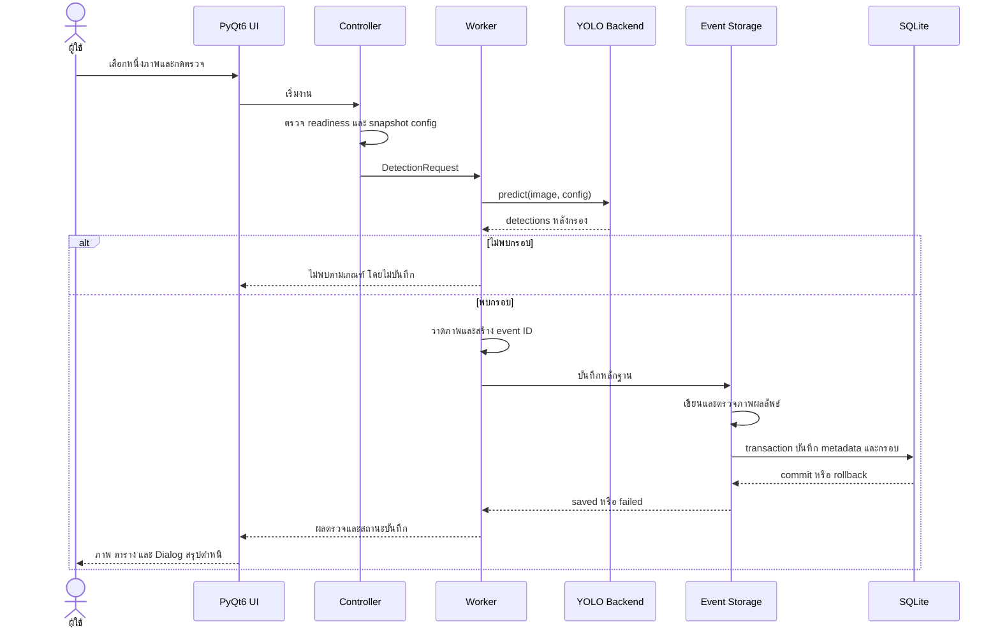

# สถาปัตยกรรมระบบตรวจจับตำหนิ PCB ด้วย YOLO11

วันที่จัดทำ: 15 ตุลาคม 2026

เอกสารนี้อธิบายโครงสร้างต้นแบบตาม [Requirement.md](Requirement.md) และ [design.md](design.md) ใช้ชื่อไฟล์ `artitecture.md` ตามที่ผู้ใช้ขอ เป็นแอปเดสก์ท็อปออฟไลน์ ผู้ใช้เดียว ตรวจครั้งละหนึ่งภาพ เพื่อการเรียนรู้ ไม่กำหนดตัวเลขความแม่นยำหรือเวลาขั้นต่ำ งานฝึกและประเมินเตรียมเป็นสคริปต์ ยังไม่เริ่มเทรนตามคำสั่งผู้ใช้

## 1. ภาพรวม

แยกงานเป็นสองส่วน ได้แก่ pipeline ฝึก/ประเมินโมเดลของผู้พัฒนา และแอปตรวจภาพสำหรับผู้ใช้ ทั้งสองเชื่อมกันผ่านไฟล์น้ำหนักและ metadata ของโมเดล ไม่ต้องมี API server หรือบริการ Cloud เพื่อรันต้นแบบ



การดาวน์โหลดข้อมูล dependency และน้ำหนักตั้งต้นเกิดในขั้นเตรียมสภาพแวดล้อม หลังติดตั้งต้องไม่ดาวน์โหลดโมเดลอัตโนมัติเมื่อเปิดแอปตรวจภาพ

## 2. องค์ประกอบและหน้าที่

| ชั้น/องค์ประกอบ | หน้าที่ | สิ่งที่ไม่ควรรับผิดชอบ |
|---|---|---|
| Presentation: PyQt6 pages, Dialog, widgets | รับคำสั่ง แสดงภาพ ตาราง และสถานะ | SQL การฝึกโมเดล และ inference บน UI thread |
| Application: Controller/State | ตรวจเงื่อนไขเริ่มงาน snapshot ค่า ประสาน worker และสถานะหน้าจอ | รายละเอียดของไฟล์น้ำหนักและคำสั่ง SQL |
| Domain: DTO และนโยบายเหตุการณ์ | นิยาม request/result, class mapping, กฎพบตำหนิและการบันทึก | การอ้าง widget โดยตรง |
| Detection Backend | โหลด YOLO11 ตรวจ mapping รัน inference และคืนกรอบ | การเปิด Dialog หรือการสร้างประวัติ |
| Image Service | decode, orientation, annotation และการแปลงภาพสำหรับแสดงผล | การกำหนดว่าผลโมเดลแม่นยำพอหรือไม่ |
| Event Storage Service | ประสานภาพและ transaction รักษา event ID และชดเชยเมื่อบันทึกล้มเหลว | เรียกโมเดลซ้ำระหว่าง retry การบันทึก |
| Repository | schema, transaction, insert และ query ประวัติ | แสดง UI และแก้ไฟล์ต้นฉบับ |
| Training/Evaluation scripts | ตรวจ dataset ฝึก ทดลอง และสร้างผลประเมิน | ทำงานอัตโนมัติเมื่อผู้ใช้เปิดหน้าตรวจภาพ |

ใช้ Python, PyQt6, YOLO11, OpenCV/Pillow, SQLite และ local file system ตามรายงาน ส่วนเวอร์ชัน dependency ที่แน่นอนให้ตรึงหลังทดสอบร่วมกันบนเครื่องเป้าหมาย

## 3. Thread และวงจรชีวิต

- Main thread เป็นเจ้าของ widget และอัปเดตหน้าจอผ่าน Qt signals เท่านั้น
- worker ทำงานอ่านภาพ inference วาดภาพ และบันทึกผลที่อาจใช้เวลา มีงานตรวจ active ได้หนึ่งงาน
- Backend โหลดหนึ่งครั้งต่อรุ่นโมเดลใน worker context และไม่ถูกเรียกพร้อมกันจากหลาย thread
- UI ใช้ QPixmap บน main thread; worker คืนข้อมูลภาพหรือ QImage ที่ไม่ถูกแก้พร้อมกันหลังส่ง
- การเขียนฐานข้อมูลสร้าง connection ใน thread ที่ใช้จริง ไม่ส่ง connection จาก `AppState` บน main thread ไปใช้ใน worker
- การอ่านประวัติใช้ connection แยกและคืนค่าข้อมูลที่ไม่ผูกกับ cursor หากข้อมูลมากขึ้นให้ย้าย query ออกจาก UI thread
- เปลี่ยนโมเดลหรือปิดแอปเมื่อไม่มีงาน active หรือรอให้งานถึงจุดหยุดที่ปลอดภัยก่อนทำความสะอาด worker/thread
- ถ้าเพิ่มปุ่มยกเลิกภายหลังต้องระบุว่ายกเลิกที่ขอบเขตขั้นตอน ไม่รับรองว่าจะขัดจังหวะ inference กลางคำนวณได้

## 4. ลำดับตรวจจับและบันทึก



เมื่อ inference เกิด exception ให้ส่ง failure signal แยกจากผล detections ว่าง เมื่อการบันทึกล้มเหลวให้คงผลตรวจเดิมไว้ แต่ไม่ประกาศว่าเหตุการณ์ถูกเก็บสำเร็จ กลไกชดเชยไฟล์และการกู้คืนหลัง crash ใช้ตาม design.md §7

## 5. โครงสร้างไฟล์เป้าหมาย

```text
project/
├── Requirement.md
├── design.md
├── artitecture.md
├── main.py                     # entry point แอป
├── app/
│   ├── config.py               # ชื่อแอป path และค่าทดลอง PCB
│   ├── state.py                # สถานะและการควบคุมงาน
│   ├── models.py               # DTO; แยกจาก PyQt widgets
│   ├── detector.py             # backend และ worker
│   ├── image_service.py        # อ่านและวาดภาพ
│   ├── storage.py              # ประสานภาพกับฐานข้อมูล
│   ├── db.py                   # SQLite repository
│   ├── image_view.py           # ซูม เลื่อน และพอดีกรอบ
│   ├── model_registry.py       # mapping และ checksum โมเดล
│   ├── runtime.py              # ค่า Ultralytics ออฟไลน์ในโฟลเดอร์งาน
│   └── pages/
│       ├── upload_page.py
│       ├── result_page.py
│       └── history_page.py
├── scripts/                    # ตรวจข้อมูล ฝึก ประเมิน และส่งออกโมเดล
├── configs/train.yaml          # ค่าฝึกเพื่อทดลองภายหลัง
├── reports/                    # ผลตรวจข้อมูลและแผนฝึก dry run
├── models/pcb/                 # best.pt และ metadata.json
├── data/pcb_detections.db
├── outputs/pcb/YYYY/MM/DD/
├── experiments/                # config, metrics และกราฟแต่ละการทดลอง
├── tests/                      # ทดสอบซอฟต์แวร์ แยกจากชุดข้อมูล test/
├── train/
├── valid/
├── test/                       # ชุดภาพประเมินโมเดล
├── data.yaml
├── requirements.txt            # dependency แอปที่ทดสอบแล้ว
└── requirements-train.txt      # dependency การฝึกที่ทดสอบแล้ว
```

โมดูลในโครงสร้างนี้พัฒนาแล้ว แต่ `best.pt`, metadata ของโมเดลที่ฝึกแล้ว และผลการฝึกยังไม่มี ฐานข้อมูลและหลักฐานสร้างเมื่อใช้งานจริง ไม่สร้างข้อมูลผลจำลองในประวัติจริง

## 6. Pipeline ข้อมูลและโมเดล

### 6.1 เตรียมข้อมูล

อ้างชื่อคลาสจาก `data.yaml` ตรวจภาพเสีย label หาย class ID ผิด พิกัดไม่ถูกต้อง และภาพซ้ำข้าม split ก่อนฝึก บันทึกจำนวนไฟล์จริงและเหตุผลที่ต่างจากรายงาน

`data.yaml` ปรับให้อ้าง `train/images`, `valid/images`, `test/images` จาก root ที่อยู่ร่วมกับ YAML แล้ว สคริปต์ของโครงการ resolve path จากตำแหน่ง YAML และสร้าง YAML ที่ใช้ absolute path ใน experiment ก่อนส่งให้ Ultralytics เพื่อไม่ขึ้นกับ datasets_dir ของเครื่อง

เมื่อพบภาพที่มาจากต้นฉบับเดียวกันข้าม split ให้จัดกลุ่มต้นทางก่อนแบ่งใหม่และบันทึก manifest ไม่เลือกสัดส่วนใหม่เพียงเพื่อให้ตรงกับตัวเลขใน overview.md ถ้าติดตามต้นทางไม่ได้ต้องระบุข้อจำกัดของการประเมิน

### 6.2 ฝึกและประเมิน

แต่ละ experiment เก็บ dataset version/manifest, class mapping, seed, pretrained weights, ขนาด YOLO11, epochs, batch size, image size, learning rate, augmentation, dependency versions และรายละเอียดเครื่อง

เลือก best weights และ threshold ด้วย validation ตรึงค่าแล้วประเมิน test รายงาน Precision, Recall, F1-score, mAP ทั้งสองแบบ เวลา และตัวอย่างความผิดพลาด เป้าหมายคืออธิบายสิ่งที่เรียนรู้จากผล ไม่ใช่ผ่านคะแนนขั้นต่ำ

### 6.3 ส่งโมเดลเข้าแอป

`models/pcb/metadata.json` ควรมี model ID, SHA-256 ของน้ำหนัก, class mapping, image size, ค่า Confidence/NMS IoU ที่ใช้ทดลอง, experiment ID, วันที่สร้าง และ dependency versions ที่ทดสอบแล้ว

ตอนโหลดให้เทียบ metadata กับชื่อคลาสจากโมเดลและ mapping PCB หากไม่ตรงให้ปิดการตรวจจริง ไม่ใช้ dictionary ของคลาสถนนแทน และไม่สลับเป็นผลจำลองโดยไม่แจ้งผู้ใช้

## 7. การตัดสินใจทางสถาปัตยกรรม

| รหัส | การตัดสินใจ | เหตุผลและผลกระทบ |
|---|---|---|
| ADR-01 | Desktop ออฟไลน์เครื่องเดียว | ตรงกับ third draft ลดความจำเป็นของ server และบัญชีผู้ใช้ |
| ADR-02 | ตรวจทีละภาพ | ผู้ใช้ยืนยัน ลดความซับซ้อนของ queue และ Dialog หลายภาพ |
| ADR-03 | SQLite + ภาพบน local file system | ตรงกับรายงาน ต้องมีวิธีรับมือการบันทึกที่สำเร็จเพียงบางส่วน |
| ADR-04 | บันทึกเฉพาะเหตุการณ์ที่พบตำหนิ | ตรงกับขอบเขตภาพหลักฐาน แต่ประวัติไม่ใช่จำนวนการตรวจทั้งหมด |
| ADR-05 | แยกฝึกออกจากแอป | ควบคุมการทดลองและเปลี่ยนโมเดลได้โดยไม่เพิ่มภาระ UI |
| ADR-06 | ไม่ใช้ mock อัตโนมัติในโหมดใช้งานจริง | ป้องกันผลสุ่มถูกเข้าใจว่าเป็นการตรวจ PCB และถูกเก็บปะปน |
| ADR-07 | ใช้ฐานข้อมูล PCB ใหม่ | ป้องกัน class ID เดียวกันถูกตีความข้ามโดเมนถนนกับ PCB |
| ADR-08 | รายงานประสิทธิภาพโดยไม่มีเกณฑ์ขั้นต่ำ | สอดคล้องเป้าหมายการเรียนรู้ที่ผู้ใช้ยืนยัน |

## 8. สถานะการพัฒนาต้นแบบ

| ส่วน | การพัฒนาที่ทำแล้ว |
|---|---|
| config และภาพนำเข้า | PCB 6 คลาสและ JPG/JPEG/PNG ทีละภาพ |
| detector และ state | worker ถาวร โหลดโมเดลและตรวจนอก UI thread ไม่มี fallback จำลองอัตโนมัติ |
| image_view และหน้าผล | ภาพต้นฉบับ/ผล ซูม เลื่อน ตาราง และสรุปคลาส |
| storage และ db | timestamp + event ID, PNG, SQLite transaction, ชดเชยไฟล์เมื่อบันทึกพลาด และ retry |
| history | ค้นชื่อ คลาส ช่วงวันที่ และเปิด metadata แม้หลักฐานหาย |
| registry | ตรวจชื่อคลาสและ checksum ก่อนโหลดโมเดลจริง |
| scripts | ตรวจ dataset, dry run, โค้ดฝึก ประเมิน และส่งออกที่ต้องเรียกแยก |
| main.py | entry point แอป พร้อม --mock ที่ไม่บันทึกประวัติจริง |

ทดสอบซอฟต์แวร์ด้วย fixture และทดสอบการเชื่อมต่อ Ultralytics ด้วยน้ำหนักสุ่มชั่วคราวโดยไม่ฝึก การทดสอบดังกล่าวไม่ใช่ผลประเมินคุณภาพโมเดล PCB ผลทดสอบและข้อจำกัดอยู่ใน README.md และ reports/validation.md

ไม่แปลงประวัติถนนเดิมเป็น PCB โดยอาศัย class ID เพราะ ID เดียวกันมีความหมายคนละประเภท

## 9. แนวทางตรวจสอบและส่งมอบ

ทดสอบหน่วยเฉพาะกฎที่สำคัญ ได้แก่ mapping, จำนวนและ Confidence สรุป, การตั้งชื่อไม่ชน, transaction rollback และการไม่บันทึกผลว่าง/จำลอง จากนั้นทดสอบ integration ตั้งแต่เลือกภาพจนเปิดประวัติใหม่ และทดสอบ UI ตาม AT-01 ถึง AT-11

ทดสอบบนเครื่องเป้าหมายจริงหนึ่งครั้งโดยตัดเครือข่ายหลังติดตั้ง ตรวจ path ที่มีช่องว่าง/ภาษาไทยและสิทธิ์เขียนข้อมูล จัดเตรียมคู่มือที่ระบุวิธีติดตั้ง dependency วางโมเดล เปิดแอป ตำแหน่งเก็บหลักฐาน และวิธีสำรอง SQLite พร้อมโฟลเดอร์ภาพเป็นชุดเดียวกัน

ไม่มีข้อสรุปว่าโมเดลเร็วหรือแม่นยำเพียงพอจนกว่าจะวัดจริง และไม่มีเงื่อนไขบังคับให้ผลถึงตัวเลขใดสำหรับงานเรียนรู้นี้
