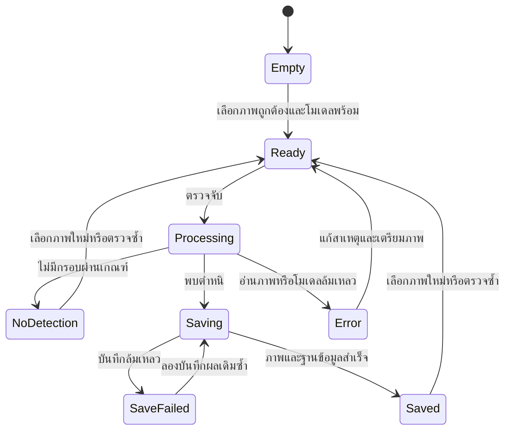
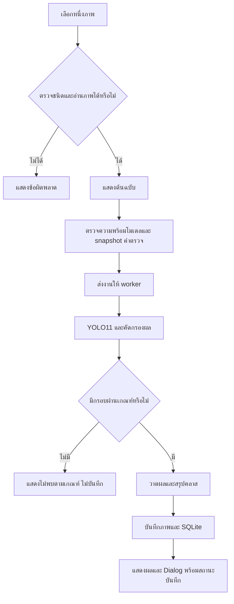
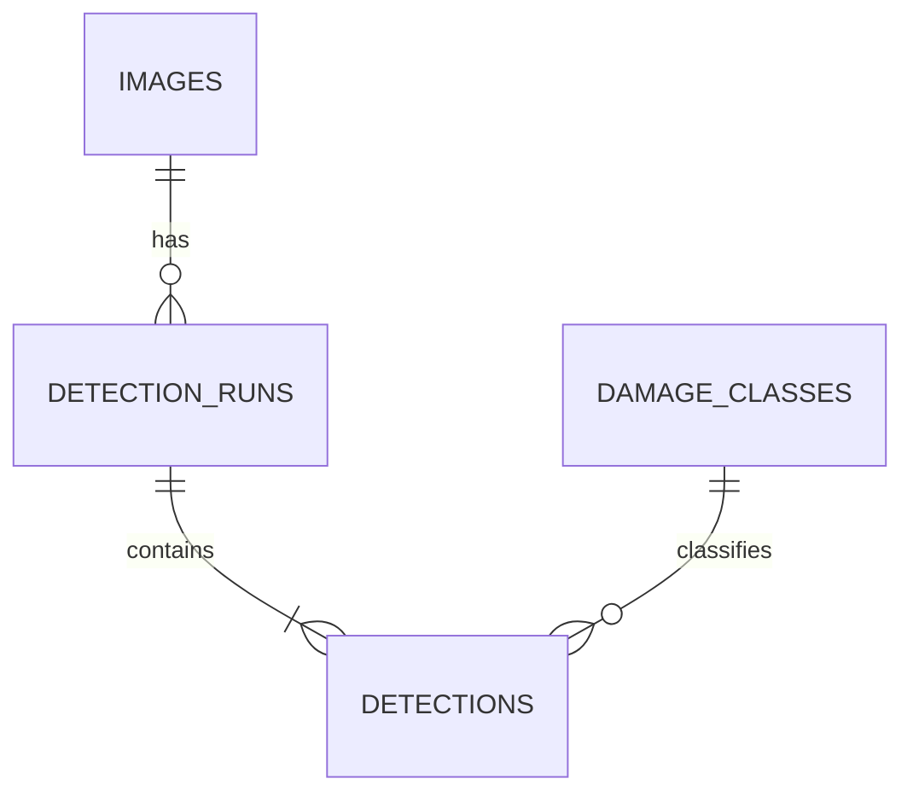

# การออกแบบระบบตรวจจับตำหนิ PCB ด้วย YOLO11

วันที่จัดทำ: 15 ตุลาคม 2026

เอกสารนี้แปลง [Requirement.md](Requirement.md) เป็นแนวทางพัฒนาต้นแบบตรวจภาพทีละภาพสำหรับการเรียนรู้ อ้างอิง `report/third draft.pdf` ตามที่ผู้ใช้ยืนยัน รายละเอียดหน้าจอ โครงสร้างข้อมูล และการจัดการข้อผิดพลาดด้านล่างเป็นแบบออกแบบที่ใช้พัฒนาต้นแบบแล้ว งานฝึกโมเดลเตรียมเป็นโค้ดและยังไม่เริ่มฝึกตามคำสั่งผู้ใช้

## 1. หลักการออกแบบ

ผู้ใช้ต้องเห็นภาพต้นฉบับเทียบผลตรวจได้ เข้าใจว่าพบคลาสใดกี่ตำแหน่ง และแยกผลตรวจออกจากสถานะการบันทึกได้ ระบบทำงานครั้งละหนึ่งภาพและหนึ่งงานตรวจจับ ผลที่ไม่มีกรอบผ่าน threshold ใช้คำว่า “ไม่พบความเสียหายตามเกณฑ์ที่ตั้งไว้” ไม่แปลเป็นการรับรองว่าชิ้นงานไม่มีตำหนิ

ใช้หน้าหลักสองหน้า ได้แก่ **ตรวจภาพ** และ **ประวัติการตรวจพบ** การฝึกโมเดลและการประเมินเป็นงานของผู้พัฒนานอก UI ไม่เพิ่มหน้าฝึกโมเดลในต้นแบบ

## 2. หน้าตรวจภาพ

```text
ระบบตรวจจับตำหนิ PCB                 [ตรวจภาพ] [ประวัติ]
โมเดล: <รุ่น>     สถานะ: พร้อม / ไม่พร้อม / โหมดจำลอง
[เลือกภาพ] <ชื่อไฟล์>                 [ตรวจจับ]

+-------------------------+--------------------------+
| ภาพต้นฉบับ              | ภาพผลลัพธ์พร้อมกรอบ       |
| รักษาอัตราส่วนภาพ        | ซูม/เลื่อนเพื่อดูตำหนิเล็ก  |
+-------------------------+--------------------------+
สถานะ: <ข้อความ>     เวลา inference: <ms>
จำนวนตำแหน่ง: <n>    คลาสที่พบ: <รายการและจำนวน>
คลาส | Confidence | x1 | y1 | x2 | y2
...
การบันทึก: ไม่จำเป็น / กำลังบันทึก / สำเร็จ / ไม่สำเร็จ
ค่าที่ใช้: Confidence <ค่า>  NMS IoU <ค่า>  Image size <ค่า>
```

| องค์ประกอบ | พฤติกรรม |
|---|---|
| เลือกภาพ | ใช้ file picker แบบเลือกไฟล์เดียว กรอง JPG/JPEG/PNG แล้วตรวจว่า decode ได้จริง |
| ภาพต้นฉบับ | แสดงไฟล์ที่เลือก รักษาสัดส่วนและใช้ภาพที่ normalize orientation แล้วเป็นฐานพิกัด |
| ตรวจจับ | เปิดเมื่อมีภาพถูกต้องและโมเดลพร้อม ปิดระหว่างประมวลผล/บันทึก |
| ภาพผลลัพธ์ | วาดกรอบ ชื่อคลาส และ Confidence ลงบนสำเนา ไม่แก้ไฟล์นำเข้า |
| ตารางรายละเอียด | หนึ่งแถวต่อกรอบ เรียง Confidence มากไปน้อย แสดงพิกัดของภาพที่ประมวลผล |
| สรุป | แสดงจำนวนกรอบรวมและจำนวนแยกคลาส ไม่ใช้จำนวนคลาสแทนจำนวนตำแหน่ง |
| สถานะการทำงาน | แสดงขั้นตอน “กำลังอ่านภาพ/กำลังตรวจจับ/กำลังบันทึก” ไม่แสดงเปอร์เซ็นต์ที่วัดไม่ได้ |

เมื่อเลือกภาพใหม่ให้ล้างผลภาพก่อนหน้าและปิด Dialog เก่าที่เกี่ยวข้อง ไม่เปลี่ยนภาพหรือโหลดโมเดลใหม่ระหว่างงานตรวจที่ยังไม่เสร็จ

### 2.1 Dialog แจ้งเตือน

ชื่อ Dialog: **พบความเสียหายบน PCB** แสดงชื่อภาพ รายการคลาสพร้อมจำนวน จำนวนตำแหน่งทั้งหมด และสถานะการบันทึก กด “รับทราบ” เพื่อกลับมาดูรายละเอียด เปิด Dialog หนึ่งครั้งต่อการตรวจที่พบตำหนิ ไม่เปิดแยกทีละกรอบ

ถ้าบันทึกล้มเหลว ยังต้องแจ้งว่าตรวจพบตำหนิ แต่แสดง “ตรวจพบความเสียหาย แต่บันทึกหลักฐานไม่สำเร็จ” พร้อมสาเหตุที่อ่านเข้าใจได้ ผลยังอยู่ในหน่วยความจำเพื่อให้ลองบันทึกซ้ำได้

### 2.2 สถานะหน้าจอ



สถานะโมเดลไม่พร้อมเป็นเงื่อนไขปิดปุ่มตรวจในทุกสถานะ โหมดจำลองต้องเปิดโดยผู้พัฒนาอย่างชัดเจน และไม่เข้ากระบวนการบันทึกหลักฐานจริง

## 3. หน้าประวัติการตรวจพบ

แสดงรายการที่บันทึกสำเร็จ เรียงวันเวลาล่าสุดก่อน มีวันเวลา ชื่อไฟล์ต้นฉบับ คลาส จำนวนตำแหน่ง Confidence สูงสุด และรุ่นโมเดล เลือกรายการเพื่อดูภาพผลลัพธ์และกรอบทั้งหมด

การกรองตามวันที่ ชื่อไฟล์ และคลาสเป็นข้อเสนอเพื่อให้ค้นหาสะดวก ไม่จำเป็นต้องมีการลบหรือส่งออกในต้นแบบ เมื่อไฟล์ภาพถูกย้ายหรือหายให้ยังแสดง metadata พร้อมข้อความ “ไม่พบไฟล์หลักฐาน” โดยไม่แทนที่ด้วยภาพอื่น

ไม่มีผลไม่พบตำหนิในหน้านี้ตามนโยบายเก็บเฉพาะเหตุการณ์ที่พบตำหนิ จึงไม่ใช้จำนวนเหตุการณ์ในประวัติคำนวณอัตราของเสียหรือจำนวนภาพที่ตรวจทั้งหมด

## 4. ลำดับการทำงาน



ข้อผิดพลาดจากโมเดลส่งไปสถานะ Error โดยตรง ไม่ส่งเข้าทาง “ไม่มีกรอบ” และไม่เปลี่ยนเป็นผลตรวจปกติ

## 5. ข้อตกลงข้อมูลระหว่างโมดูล

| โครงสร้าง | ฟิลด์หลัก | กติกา |
|---|---|---|
| DetectionRequest | request_id, source_path, model_id, conf, nms_iou, imgsz | คัดลอกค่าไว้เมื่อเริ่มงาน ไม่เปลี่ยนกลางงาน |
| Detection | class_id, class_name, confidence, x1, y1, x2, y2 | class ID 0–5 และชื่อสอดคล้อง mapping; confidence อยู่ใน [0,1] |
| DetectionResult | request_id, detected_at, width, height, detections, inference_ms, annotated_image, is_mock | ใช้ detections ว่างสำหรับผลไม่พบ; ใช้ error แยกสำหรับประมวลผลล้มเหลว |
| SaveResult | event_id, status, result_path, error_message | status เป็น saved หรือ failed; ไม่มี path สำเร็จที่ชี้ไฟล์ซึ่งยังเขียนไม่จบ |

พิกัดกรอบใช้หน่วยพิกเซลหลัง normalize orientation โดยมี `0 <= x1 < x2 <= width` และ `0 <= y1 < y2 <= height` การปรับขนาดภาพแสดงผลต้องไม่เปลี่ยนพิกัดที่บันทึก ไม่คูณอัตราขยายซ้ำกับพิกัดที่ backend คืนในขนาดต้นฉบับแล้ว

เก็บเวลาเป็น ISO 8601 พร้อม timezone offset ของเครื่อง ใช้เวลาตรวจเสร็จเดียวกันสร้าง metadata และโฟลเดอร์ ตัวอย่างสำหรับเครื่องที่ตั้ง Asia/Bangkok คือ `2026-10-15T15:40:12+07:00`

## 6. การออกแบบฐานข้อมูล

ใช้ฐานข้อมูลใหม่ `data/pcb_detections.db` เพื่อแยกจากประวัติตรวจถนนเดิม ตารางต่อไปนี้ใช้ใน `app/db.py` แล้ว โดยเพิ่ม `total_ms` สำหรับเวลาอ่านภาพ ตรวจจับ และวาดกรอบ ซึ่งไม่รวมการเขียนหลักฐาน



| ตาราง | คอลัมน์สำคัญ |
|---|---|
| images | id PK, original_name TEXT, source_path TEXT, width INTEGER, height INTEGER |
| detection_runs | id PK, event_id TEXT UNIQUE, image_id FK, detected_at TEXT, model_id TEXT, model_sha256 TEXT, conf_threshold REAL, iou_threshold REAL, imgsz INTEGER, inference_ms REAL, result_path TEXT UNIQUE, detection_count INTEGER, max_confidence REAL |
| detections | id PK, run_id FK, class_id FK, class_name TEXT, confidence REAL, x1 REAL, y1 REAL, x2 REAL, y2 REAL |
| damage_classes | id PK, name TEXT UNIQUE, display_name_th TEXT |

ข้อบังคับของแบบข้อมูล:

- เปิด foreign keys และใช้ transaction สำหรับเพิ่ม image, run และ detections ทั้งชุด
- `detection_count > 0` เพราะตารางนี้เก็บเฉพาะเหตุการณ์ตำหนิที่บันทึกสำเร็จ
- `detection_count` เท่ากับจำนวนแถวใน detections ของ run นั้น และ `max_confidence` เท่ากับค่าสูงสุดจริง
- เก็บชื่อคลาสเป็น snapshot ใน detections เพื่อรักษาความหมายของผลเก่าเมื่อปรับคำแปล
- กำหนด NOT NULL ให้ฟิลด์ที่ต้องมีในเหตุการณ์สำเร็จ และ CHECK สำหรับ Confidence/threshold ใน [0,1] และขนาดภาพมากกว่าศูนย์
- ทำดัชนี `detected_at`, `run_id` และ `class_id` ตามคำค้นประวัติ
- query คลาสใช้ EXISTS หรือ join ที่ควบคุมการนับ เพื่อไม่ทำให้จำนวนกรอบซ้ำจากการ join

ต้นแบบเก็บสำเนาภาพที่ทำเครื่องหมายแล้วเป็นหลัก ส่วน `source_path` เป็นเพียงตำแหน่งอ้างอิงต้นฉบับ ไม่รับประกันว่าจะเปิดต้นฉบับย้อนหลังได้หากผู้ใช้ย้ายไฟล์

## 7. การจัดเก็บภาพและความสอดคล้อง

```text
outputs/pcb/2026/10/15/20261015_154012_<event_id>_annotated.png
data/pcb_detections.db
models/pcb/best.pt
models/pcb/metadata.json
```

ชื่อไฟล์คง timestamp ตามรายงานและเพิ่ม event ID เพื่อกันชื่อชน PNG เป็นรูปแบบผลลัพธ์ที่เสนอเพื่อไม่เพิ่มความสูญเสียจากการบีบอัดอีกครั้ง

ขั้นตอนบันทึกที่เสนอ:

1. สร้าง event ID หนึ่งครั้งสำหรับผลตรวจนั้น และเขียนภาพลง temporary file ในโฟลเดอร์ปลายทาง
2. ตรวจผลการเขียนและเปิดอ่านได้ก่อนเปลี่ยนเป็นชื่อจริง โดยไม่ทับไฟล์ที่มีอยู่
3. บันทึกแถวทั้งหมดใน SQLite transaction แล้ว commit เมื่อข้อมูลครบ
4. หาก transaction ล้มเหลวให้ rollback และลบเฉพาะไฟล์ใหม่ของ event นี้ หากลบไม่สำเร็จให้บันทึกเป็น orphan เพื่อจัดการภายหลัง
5. แจ้ง saved เฉพาะเมื่อไฟล์และฐานข้อมูลสำเร็จทั้งคู่ การลองบันทึกซ้ำใช้ event ID เดิมและตรวจรายการเดิมก่อนเพื่อไม่สร้างซ้ำ

ไฟล์กับ SQLite ไม่ได้อยู่ใน transaction เดียวกัน หากแอปปิดกะทันหันอาจเหลือไฟล์ที่ไม่มีแถวอ้างอิง จึงให้ตรวจความสอดคล้องตอนเริ่มแอปและรายงานไฟล์ค้าง ไม่ลบหลักฐานที่ไม่ทราบเจ้าของโดยอัตโนมัติ

## 8. การตั้งค่าและข้อผิดพลาด

ค่าเริ่มต้นเพื่อทดลองอาจใช้ Confidence 0.25, NMS IoU 0.45 และ image size 640 ตามโค้ดเดิม แต่ยังไม่ใช่ค่าที่พิสูจน์ว่าเหมาะกับ PCB ต้องระบุค่าใช้งานจริงในผลทดลอง การเลือกขนาด YOLO11 และพารามิเตอร์ฝึกให้บันทึกแยกจากค่าตรวจใน UI

| เหตุการณ์ | ข้อความ/การตอบสนอง |
|---|---|
| ยังไม่มีภาพ | “กรุณาเลือกภาพ PCB ก่อนตรวจจับ” |
| ไฟล์อ่านไม่ได้ | “ไม่สามารถอ่านไฟล์ภาพนี้ได้” พร้อมชื่อไฟล์ |
| โมเดลหายหรือโหลดไม่ได้ | ระบุสาเหตุและปิดปุ่มตรวจจริง |
| mapping คลาสไม่ตรง | “โมเดลไม่ตรงกับชุดคลาส PCB ที่กำหนด” และไม่เดาคลาสแทน |
| inference ล้มเหลว | แจ้งตรวจไม่สำเร็จ เก็บรายละเอียดเชิงเทคนิคใน log |
| ไม่พบกรอบ | แสดงผลไม่พบตามเกณฑ์ ไม่เปิด Dialog ตำหนิ |
| บันทึกไม่ได้ | แสดงผลตรวจพร้อมสถานะบันทึกไม่สำเร็จ ให้ลองบันทึกซ้ำ |

## 9. การตรวจสอบแบบออกแบบ

ใช้ AT-01 ถึง AT-11 ใน [Requirement.md](Requirement.md) เป็นกรณีหลัก เพิ่มการตรวจว่าตารางและกรอบตรงกันหลังซูม การเลือกภาพใหม่ไม่ค้างผลเก่า การค้นหาประวัติไม่ทำให้จำนวนซ้ำ และการปิดหน้าต่างระหว่างงานไม่ทำลาย worker ที่กำลังทำงาน

ไม่มีการตรวจรับด้วยเกณฑ์ความแม่นยำหรือความเร็วขั้นต่ำ ผลโมเดลและเวลาเป็นข้อมูลสำหรับวิเคราะห์การเรียนรู้ตามที่ผู้ใช้กำหนด
